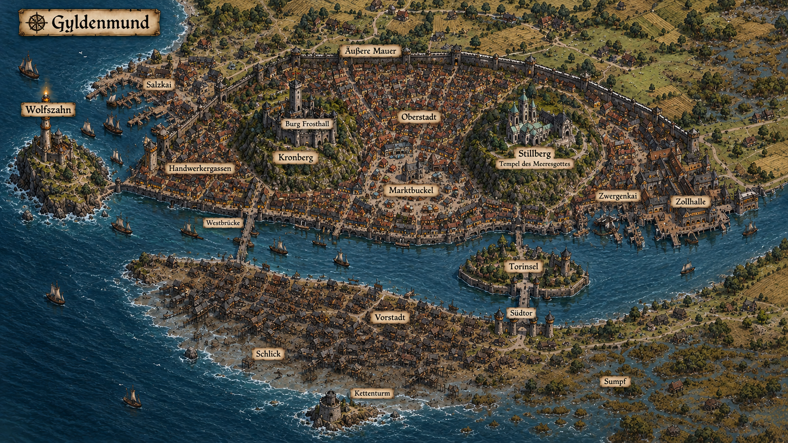

# Gyldenmund – Architektur-Portfolio (v2, angepasst an die Karte)

Dieses Dokument hat zwei Teile:

1. **Stadtaufbau nach deiner Karte**: Änderungsprotokoll und angepasste Beschreibung.
2. **Bild-Portfolio**: Style-Bibel, Prompts und Negativ-Prompts für ein Bildgenerierungs-Tool. Die Prompts sind auf **Englisch**, weil die meisten Tools damit die besten Ergebnisse liefern.

---

# TEIL 1 – Stadtaufbau

## 1.1 Orientierung und Namenszuordnung

| Karte | Deutscher Name | Lage |
|---|---|---|
| Light tower (grüne Halbinsel) | **Wolfszahn** (Leuchtturm + Küstenfestung) | äußerster Westen, ragt ins Meer |
| Salt Kai | **Salzkai** (Seehafen) | Nordwesten, an der Küste, **außerhalb** der Mauer |
| Handwerker | **Handwerkergassen** (früher „Ostgassen“) | Westen, flussabwärts |
| Crown Hill | **Kronberg** mit Burg Frosthall | Westmitte, am Südufer des Flusses |
| Mercantile Buckle | **Marktbuckel** | Mitte |
| Hill of Thought | **Stillberg** (Tempel, Kloster, Hospital) | Osten |
| Docks | **Zwergenkai** (Flusshafen) | Osten, flussaufwärts |
| Gate (Insel mit Brücke) | **Torinsel** (Zollburg + Brückentor) | Fluss, östlich der Mitte |
| Pre-city | **Vorstadt** und **Schlick** (Slum) | Südufer |
| Outer city wall | **Äußere Mauer** | Norden, Osten und Westen; offen zum Meer |

**Himmelsrichtungen:** Meer = Westen, Fluss fließt von Osten nach Westen, Landesinneres = Norden und Osten, das sumpfige Südufer liegt gegenüber der Stadt.

## 1.2 Einschätzung der Karte

Die neue Anordnung ist **in sich schlüssiger** als meine erste Version, weil sich vieles von selbst ergibt:

- **Die Flussrichtung erklärt die Stadt.** Wasser kommt im Osten sauber an, wird nach Westen immer schmutziger. Handwerk und Gerbereien liegen flussabwärts, Tempel und Docks flussaufwärts. Das ist realistisch.
- **Der Goldweg führt mitten durch die Stadt.** Das Gold kommt im Osten an und muss zur Burg im Westen. Es muss also quer durch Marktbuckel und Oberstadt. Das gibt dir Prozessionen, Hinterhalte und Spektakel.
- **Der Tempel sitzt an den Docks.** Der Stillberg sieht alles, was ankommt, und kontrolliert (siehe Wasser) die Quelle der Stadt.
- **Der Seehafen ist von der Stadt getrennt.** Seeleute, Schmuggler und Lotsen leben im Außenbereich. Das passt zu dem Gedanken, dass der Seehandel zweitrangig ist.

## 1.3 Kritische Änderungen

### A) Der Fluss ist schmaler als gedacht
Auf der Karte ist der Fluss an der Stadt etwa 300 bis 600 m breit. Der **fünf Kilometer breite Trichter** liegt erst an der Mündung im Südwesten, zwischen Wolfszahn und dem Südufer. Die Gezeiten und der Salzkeil reichen trotzdem bis in die Stadt, daher bleibt das Flusswasser im Stadtgebiet **nicht trinkbar**.

### B) Burg Frosthall: neue Ausrichtung
Der Kronberg liegt nicht mehr direkt am Meer, sondern am Fluss.
- Die **Steilwand (ca. 40 m) zeigt nach Süden zum Fluss**. Dort entsteht der berühmte Anblick vom Südufer und von der Brücke aus.
- Der **Zugang (Weg der Neun Kehren)** führt von Osten, vom Marktbuckel her, den Hang hinauf.
- Die **Oberstadt (Goldstufe)** liegt am Ost- und Nordosthang, zwischen Burg und Markt.
- Vom Bergfried sieht man im Westen das Meer, die Rauchfahne („Fahne des Königs“) ist dort weiterhin sichtbar.
- Neu: eine **Wasserpforte** am Fuß der Klippe mit Treppe zum Fluss, für Boote des Königs und für Gefangenentransporte.

### C) Zollinsel wird zur Torinsel
Auf der Karte liegt die Insel **westlich** der Docks, also flussabwärts. Das löst ein Logikproblem: Die Lastkähne legen zuerst an den Docks an, bevor sie die Insel erreichen. Lösung:
- **Die Zollstelle liegt am Zwergenkai**, in der **Zollhalle** (Fracht wird dort geprüft und verzollt).
- Die **Torinsel** trägt das **Südtor**, die einzige befestigte Brücke zur Vorstadt. Zusätzlich ist sie eine **Flusssperre**: Die Brücke hat eine Hubbrücke und eine Kette, sodass **nichts flussabwärts weiterfahren kann**, was die Stadt nicht will.
- Daraus folgt: Der Zwergenkai ist die Endstation der Lastkähne, und der Fluss im Westteil (an Marktbuckel, Kronberg, Handwerkern) ist ein **innerer Wasserweg** nur für zugelassene Boote.

### D) Die Kette
Die Eisenkette sperrt nicht mehr bei der Zollinsel, sondern die **Mündung**: vom **Wolfszahn** zu einem **Kettenturm auf einer Sandbank/Landzunge am Südufer** vor der Vorstadt. Er ist halb im Wasser gebaut und wird bei Sturmflut oft überspült.

### E) Mauer mit Lücken
Die Mauer ist alt, bei Weitem nicht mehr dicht und bildet nur noch einen Ring um die alte Kernstadt.
- **Ohne Mauerschutz:** Salzkai, Wolfszahn (haben eigene Palisaden und Festung), Vorstadt, Schlick und alle Höfe im Landesinneren.
- **Mauer klebt an Häusern:** An vielen Stellen sind Hütten und Anbauten an die Mauer gebaut, teils mit Löchern für Türen. Das ist ein Streitpunkt mit dem König.
- **Es fehlt eine Mauer zum Fluss.** Ein Fluss ist keine Verteidigung. Lösung: **Kaimauer mit Wassertoren** entlang der gesamten Nordseite des Flusses.
- **Tore (Vorschlag):** Westtor (Brücke bei den Handwerkern), Nordtor, **Ost-/Bauerntor** (dort, wo die Mauer auf den Fluss trifft), Wassertore am Fluss.

### F) Zwei Brücken
- **Westbrücke** (bei den Handwerkern): gemauert, breit, belebt. Verbindet die Küstenstraße im Süden mit dem Westtor.
- **Torinsel-Brücke** (Osten): gesichert, mit Zoll für alle, die in die Stadt wollen.
- Wer das Brückengeld nicht zahlen kann, bleibt **in der Vorstadt**. Das erklärt, warum sie wächst.

### G) Wasserversorgung
Der Zwergenkanal kommt nun **aus Osten** und erreicht zuerst den **Stillberg**.
- Der **Tempel bekommt das Wasser zuerst**, verteilt es und hat damit Macht. Das Wasser läuft weiter über den Marktbuckel zum Kronberg.
- Die Vorstadt hat **keinen Anschluss**. Dort leben Wasserträger, Regentonnen und schlechte Brunnen.
- Die Vorstadt liegt **flussabwärts und auf Sumpfboden**, Brunnen dort sind versalzen und verschmutzt.

### H) Wind und Geruch
Gerbereien und Tranöfen liegen im Westen der Stadt, also dort, wo der Seewind herkommt.
- **Im Winter** weht ein kalter **Nordost-Wind** vom Land, der den Gestank aufs Meer treibt.
- **Im Sommer** weht eine Seebrise von Westen, die den **Gestank der Handwerkergassen über die Stadt zieht**, was ein ständiger Streitpunkt zwischen Oberstadt und Handwerkern ist. Der Adel zieht im Sommer in luftigere Gärten im Osten.

### I) Vorstadt und Schlick (Südufer)
Das Südufer war zuvor sumpfig und unbewohnt. Jetzt ist es das **Armenviertel**:
- **Brückenvorstadt** (nahe Torinsel): Händler, Fuhrleute, Gasthöfe, Karawansereien, Stallungen, Arbeiter. Dicht, aber lebendig.
- **Schlick** (zum Meer hin): Pfahlbauten, Stege, Fischer, Torfstecher, Flüchtlinge. Bei Sturmflut steht alles unter Wasser.
- Das **Dampfgässchen** (Abwärme-Kanäle) bleibt in den Handwerkergassen und zieht im Winter die Armen **über die Westbrücke** in die Stadt. Daraus ergeben sich Konflikte um Winterquartiere.

### J) Land und Bauern
- **Nördlich und östlich** der Stadt liegen Höfe mit Roggen, Gerste, Rüben und Schafen. Das Land ist karg, die Ernte unsicher.
- **Torfmoore** im Norden liefern Brennstoff.
- **Im Winter** strömen Bauern in die Vorstadt und den Schlick. Die Einwohnerzahl steigt erheblich.
- Neue Bevölkerungsschätzung: ca. **30.000 in der Mauer**, ca. **15.000 in Vorstadt, Schlick und Salzkai**, dazu mehrere Tausend Bauern im Umland.

## 1.4 Bezirke im Überblick (angepasst)

**Kronberg:** Burg Frosthall, drei Höfe, Goldkammer. Steilwand zum Fluss, Aufstieg von Osten.

**Oberstadt:** Ost- und Nordosthang des Kronbergs. Adel, Gildenhaus, Münzstätte, Funkelgasse (Juweliere und Zwergenschleifer).

**Marktbuckel:** Großer Markt, Markthalle, Bürgerhäuser. Hier laufen Goldwagen, Wasserleitung und Zollkarren aufeinander zu.

**Stillberg:** Tempel des Meeresgottes, Herd-Kapelle, Kloster, Hospital, **Wassereinlass** der Zwergenleitung, heilige Quelle.

**Zwergenkai:** Flusshafen, Zollhalle, Lagerhäuser, Steinhalle (Zwergenbotschaft).

**Torinsel:** Zollburg, Brückentor, Kettenwinde.

**Handwerkergassen:** Gerber, Färber, Schmiede, Tranöfen. Dampfgässchen. Westbrücke.

**Salzkai (außerhalb):** Seehafen, Lotsengilde, Werften, Räuchereien, Schmuggler.

**Wolfszahn (außerhalb):** Leuchtturm, Festung der Küstenwache.

**Vorstadt und Schlick (Südufer):** Karawansereien, Händler, Pfahlbauten, Stege.

**Unterstadt:** Zisternen, Zwergengänge. Neu: ein verschütteter Gang führt **unter dem Fluss** hindurch zum Südufer.

## 1.5 Neue und angepasste Abenteueraufhänger

1. **Der Goldweg:** Eine Lieferung muss vom Kai zur Burg. Jemand will sie auf dem Weg durch den Markt stehlen.
2. **Der Tempel dreht den Hahn zu:** Der Stillberg leitet weniger Wasser in die Unterstadt. Ist es Erpressung oder ein Defekt oberhalb im Kanal?
3. **Die Mauer-Frage:** Der König will die Mauer weiter ziehen und die Vorstadt abreißen. Wer profitiert?
4. **Der Gang unter dem Fluss:** Ein Zwergentunnel verbindet Burg und Südufer. Wer nutzt ihn?
5. **Der Sommergestank:** Die Oberstadt verlangt, die Gerber zu verlegen. Die Gerber drohen mit Streik.
6. **Die offene Kette:** Die Kette am Kettenturm wurde nachts durchtrennt. Ein Schiff ist unbemerkt eingelaufen.

---

# TEIL 2 – Bild-Portfolio

## 2.1 Hinweise zur Nutzung

- Jedes Bild beginnt mit dem **STYLE-BLOCK** (2.2). Kopiere ihn vor jeden Prompt, damit Stil, Farben und Material einheitlich bleiben.
- Die **Negativ-Prompts** (2.3) sind für Tools, die ein separates Feld dafür haben. Bei Tools ohne Feld hänge „no …“ an den Prompt.
- Wenn das Tool Referenzbilder oder einen festen Seed unterstützt, **verwende das erste gelungene Bild als Referenz** für alle weiteren.
- **Seitenverhältnisse** sind Empfehlungen: 16:9 für Panoramen, 3:2 für Straßenszenen, 2:3 für Türme und Fassaden.

## 2.2 STYLE-BLOCK (vor jeden Prompt setzen)

```
Dark fantasy realism, northern maritime city, cold climate, painterly concept art with
photographic detail. Architectural language: Hanseatic brick gothic meets Scandinavian
timber construction and dwarven masonry. Materials: near-black granite, pale cream-grey
dwarven cut stone for trim and carvings, steep slate roofs (50-60 degrees) with snow,
dark tarred timber, weathered red-brown brick for warehouses and guild houses, wrought
iron, green-patina copper on temples. Many tall chimneys with smoke. Small deep-set
windows with warm candlelight glow. Lighting: low northern sun or overcast sky, mist,
drifting woodsmoke, cold blue shadows against warm orange window light. Muted palette of
slate blue, charcoal, rust brown, pale grey with small accents of gold. Grounded,
lived-in, worn textures, no clean modern look.
```

## 2.3 NEGATIV-PROMPT (für alle Bilder)

```
modern buildings, neon, cartoon, anime, 3d render look, plastic, glossy, Disney castle,
fairytale pastel colors, palm trees, Mediterranean architecture, bright blue summer sky,
desert, text, watermark, logo, signature, frame, people with distorted faces, extra
limbs, blurry, low resolution, symmetrical sci-fi city, skyscrapers, cars, power lines
```

---

## 2.4 Gesamtansichten

### 01 – Stadtpanorama von der Südküste
*Aspect ratio 16:9*

```
[STYLE-BLOCK] Wide panoramic view of the fantasy port city Gyldenmund seen from the marshy
south bank across a river estuary at dusk. On the left, a rocky headland with a stone
lighthouse and fortress. In the center-left, a steep black granite hill rising straight
from the river, crowned by a huge dark castle with dozens of smoking chimneys. Right of it
a long low rounded hill covered in dense brick houses (market district), and further right
a rounded hill with a cluster of temples with copper roofs and a cloister. Fortified walls
with gaps, houses built against them. In the foreground a muddy shoreline with wooden
stilt houses and boats. A grey plume of smoke drifts from the castle out to sea. Cold
blue-grey atmosphere, mist over the water.
```

### 02 – Luftbild der Stadt
*Aspect ratio 16:9*

```
[STYLE-BLOCK] Isometric bird's-eye view of a northern medieval fantasy city on a river
flowing west into the sea. Three hills in a row along the north bank: a black granite
castle hill on the west, a rounded market hill with a big covered hall in the middle, a
temple hill with copper roofs on the east. A busy river harbor with flat barges at the
east end, a fortified island with a gatehouse and bridge in the river, a second stone bridge
in the west. Crumbling outer wall with gaps, sprawling slum of wooden houses on the south
bank, small farms and peat bogs in the northern countryside, snow on the roofs, smoke
rising from many chimneys. Detailed miniature-diorama feeling.
```

### 03 – Stadt im Winter, Nacht
*Aspect ratio 16:9*

```
[STYLE-BLOCK] Gyldenmund at night in deep winter, heavy snowfall, frozen river with a
channel kept open by an ice-breaker ship. The castle hill glows with warm orange light from
hundreds of windows, a bonfire burning at the top of the iron tower as a beacon. The slum on
the opposite bank is dark with only small flickering fires. Fog and falling snow, long
exposure feel, cold blue moonlight.
```

---

## 2.5 Kronberg und Burg Frosthall

### 04 – Burg Frosthall vom Fluss aus
*Aspect ratio 2:3*

```
[STYLE-BLOCK] Massive black granite castle on top of a 40 meter vertical cliff above a
river, seen from the water. Walls five meters thick, small deep windows, steep slate roofs
with snow, dozens of tall chimneys with smoke, a square iron-grey keep with a beacon fire on
top, a small water gate with a stone staircase at the cliff base. Dwarven bands of pale
stone and fine metal ornaments on the side facing the city. Dramatic overcast sky, ravens
circling.
```

### 05 – Der Weg der Neun Kehren
*Aspect ratio 3:2*

```
[STYLE-BLOCK] A steep serpentine stone road with nine hairpin turns winding up a granite
hill to a fortified gate with two round towers, murder holes and a portcullis, called the
Wolf Gate. Every bend is overlooked by walls above. Cobblestones, patches of snow, guards
in dark wool cloaks with wolf-head emblem, a mule cart climbing slowly. Mist in the valley
below, rooftops of an upper-class district visible.
```

### 06 – Unterer Hof (Wachhof)
*Aspect ratio 3:2*

```
[STYLE-BLOCK] Courtyard of a northern castle: barracks, stables, a smithy with glowing
forge, peat and firewood stores stacked to the roof, a armory with large siege engines
pointing toward a river. Dark granite walls, wet cobblestones, soldiers and horses, steam
from the horses, smoke from chimneys, grey winter light.
```

### 07 – Thronsaal
*Aspect ratio 16:9*

```
[STYLE-BLOCK] Great vaulted throne hall of a northern king. Ribbed vault ceiling set with
hundreds of gemstones arranged by dwarven craftsmen, reflecting firelight like a starry sky.
A dark oak throne inlaid with gold and a large amber stone, behind it a giant fireplace
with roaring fire. Long wall tapestries with sea battles, fur rugs, iron chandeliers,
courtiers in fur-trimmed robes. Warm orange light against cold stone.
```

### 08 – Der Große Saal (Festhalle)
*Aspect ratio 16:9*

```
[STYLE-BLOCK] Banquet hall in a northern castle: long oak tables with food, wall tapestries
showing hunting scenes, a musician gallery above, huge hearths at both ends, roasted
meats, ale, antlers on the walls, carved dark timber beams. Warm candlelit atmosphere.
```

### 09 – Goldkammer
*Aspect ratio 3:2*

```
[STYLE-BLOCK] Underground treasury hollowed out of solid granite. A spiral staircase with
three heavy iron doors, then a weighing chamber with large brass scales, and carved vault
niches full of gold bars and cut gemstones. Drain channels in the floor for flooding. Dwarven
runes on the walls, flickering lantern light, cold air, heavy atmosphere.
```

### 10 – Der Tiefe Schatz (Zwergentür)
*Aspect ratio 2:3*

```
[STYLE-BLOCK] A massive circular dwarven vault door set in a granite wall, covered in
interlocking runes and geometric patterns, with a small bowl-shaped recess in the center,
faint blue glow seeping from the cracks. Narrow tunnel, damp stone, a single lantern on
the floor.
```

### 11 – Wintergarten
*Aspect ratio 3:2*

```
[STYLE-BLOCK] A glass conservatory with wrought iron frame built against a castle wall in
a snowy courtyard. Inside: lemon trees, cabbages, onions, herbs, steam on the glass, warm
yellow light. Outside: snow, ice, black granite. A gardener in a wool apron tending the
plants.
```

### 12 – Heizkeller (Zwergen-Warmluftsystem)
*Aspect ratio 3:2*

```
[STYLE-BLOCK] Basement of a castle with huge iron boilers and fire chambers, brick
channels leading warm air upward through the walls, stokers shoveling peat and coal, orange
glow, steam and soot, dwarven engineering with riveted brass pipes.
```

---

## 2.6 Oberstadt

### 13 – Straße der Goldstufe
*Aspect ratio 3:2*

```
[STYLE-BLOCK] A paved street in a wealthy northern fantasy district on a hillside. Houses
of pale cut stone with slate roofs and carved gables, heated back courtyards, oil street
lamps, merchants and nobles in furs and wool, a guard patrol, a view down to the river and
the harbor. Light snowfall.
```

### 14 – Funkelgasse (Juweliere und Edelsteinschleifer)
*Aspect ratio 3:2*

```
[STYLE-BLOCK] A narrow cobbled alley lined with jeweler and gem-cutter workshops, shop
windows glittering with gemstones and gold, small signs with carved gem symbols, dwarven
and half-dwarven craftsmen at workbenches visible through the windows, lanterns, sparkling
reflections on wet stone.
```

### 15 – Gildenhaus
*Aspect ratio 2:3*

```
[STYLE-BLOCK] A large guild hall of red-brown brick with stepped gables, a clock tower, a
carved stone portal with guild emblems (ship, anvil, gem, wheat). Heavy oak double doors,
guild banners, merchants in dark coats on the stairs, cobbled square in front.
```

### 16 – Königliche Münzprägestätte
*Aspect ratio 3:2*

```
[STYLE-BLOCK] A fortified mint building of dark stone with barred windows. Inside, a
workshop with presses, furnaces and workers stamping gold coins by hand, armed guards at the
doors, glowing molten gold, soot-stained beams.
```

---

## 2.7 Marktbuckel

### 17 – Die Markthalle
*Aspect ratio 16:9*

```
[STYLE-BLOCK] Huge covered market hall of a northern fantasy city: timber roof trusses on
stone pillars, stalls with fish, smoked meat, turnips, rye bread, furs, wool and peat,
crowds in heavy winter clothes, steam from hot food stands, barrels of salted fish, hanging
lanterns, snow blowing in through the open gates.
```

### 18 – Marktplatz im Sommer
*Aspect ratio 16:9*

```
[STYLE-BLOCK] A summer market on a cobbled hilltop square under a pale, bright northern
sky, nearly white light at midnight. Colorful awnings, harbor festival banners, brick
house gables around the square, street musicians, children, dried fish racks.
```

### 19 – Der Goldzug
*Aspect ratio 16:9*

```
[STYLE-BLOCK] A heavily guarded procession of armored wagons carrying locked iron chests
through a crowded market street, escorted by royal guards in black cloaks and halberds,
crowds watching from windows and rooftops, a dwarven envoy walking alongside, tense
atmosphere.
```

---

## 2.8 Stillberg (Tempelviertel)

### 20 – Tempel des Meeresgottes
*Aspect ratio 2:3*

```
[STYLE-BLOCK] A temple of a sea god on a rounded hill: grey stone with a green-patina
copper roof, carved waves and fish on the portal, a tall bell tower, offerings of nets and
small ships at the entrance, a stone basin with water, pilgrims in wet cloaks, heavy cloud
sky.
```

### 21 – Herd-Kapelle
*Aspect ratio 3:2*

```
[STYLE-BLOCK] A small chapel dedicated to a hearth deity. In the center, a round stone
hearth with an eternal flame, surrounded by simple benches, soot on the ceiling, warm light,
loaves of bread and wood offerings, a priest feeding the fire.
```

### 22 – Kloster und Hospital
*Aspect ratio 3:2*

```
[STYLE-BLOCK] A cloister with a snow-dusted courtyard garden, covered arcades, and an
adjacent hospital hall with rows of cots, monks and nuns tending the sick, steam from
kettles, herbal bundles hanging, a soup kitchen queue at the gate.
```

### 23 – Die heilige Quelle
*Aspect ratio 3:2*

```
[STYLE-BLOCK] A natural spring flowing from a granite crevice into a carved stone basin
inside a small cave-chapel, candles and offerings around it, moss, a pale blue shimmer on
the water, a hooded priest kneeling.
```

### 24 – Wassereinlass der Zwergenleitung
*Aspect ratio 3:2*

```
[STYLE-BLOCK] A dwarven aqueduct entering a hill: a stone arched channel carrying clear
water, a large carved gate with sluices and bronze valves, a priest and a royal engineer
checking the flow, runes along the arch, morning mist.
```

---

## 2.9 Flusshafen und Torinsel

### 25 – Zwergenkai
*Aspect ratio 16:9*

```
[STYLE-BLOCK] A busy river harbor with wide flat-bottomed barges unloading crates and
sealed barrels onto paved quays. Dwarven bargemen with braided beards, armed guards,
heavy red-brick warehouses with iron doors and guard dogs, cranes, cold morning mist over
the river, snow on the stones.
```

### 26 – Zollhalle
*Aspect ratio 3:2*

```
[STYLE-BLOCK] Interior of a customs hall: tall counters, clerks with ledgers and scales,
chests being opened and inspected, a royal tax officer with a seal ring, a dwarf merchant
arguing, wax seals, lantern light, shelves of tax books.
```

### 27 – Steinhalle (Zwergenbotschaft)
*Aspect ratio 2:3*

```
[STYLE-BLOCK] A dwarven embassy building in a human city: low, wide, heavy, built from
pale cream-grey stone, round-topped doors, geometric reliefs of hammers and anvils, bronze
doors, warm light behind small windows, two dwarven guards in plate armor.
```

### 28 – Torinsel mit Brückentor
*Aspect ratio 16:9*

```
[STYLE-BLOCK] A fortified island in the middle of a river with a gatehouse, drawbridge and
a stone bridge to both banks. Chain winches, a customs fortress with two towers, boats
waiting upstream, carts queuing on the bridge, overcast sky, ice floes in the water.
```

---

## 2.10 Handwerkergassen

### 29 – Gerberei und Färberei am Fluss
*Aspect ratio 3:2*

```
[STYLE-BLOCK] A riverside tannery and dye works: drying racks with hides, vats of colored
liquids staining the river red and blue, workers in leather aprons, narrow multi-story
brick-and-timber houses leaning over alleys, thick smoke hanging low, a gloomy industrial
atmosphere.
```

### 30 – Tranöfen und Schmieden
*Aspect ratio 3:2*

```
[STYLE-BLOCK] Rendering houses with huge brick furnaces boiling whale blubber, black
smoke, barrels of oil, a blacksmith area with glowing forges next door, workers covered in
soot, steam from drains in the street, orange firelight in the fog.
```

### 31 – Das Dampfgässchen
*Aspect ratio 2:3*

```
[STYLE-BLOCK] A narrow alley in winter where warm steam rises from iron grates and stone
channels under the street. Poor people huddle on the warm cobbles, blankets, patched
clothes, children sleeping near the grates, steam clouds in the cold air, dim lanterns.
```

### 32 – Westbrücke
*Aspect ratio 16:9*

```
[STYLE-BLOCK] A wide stone arch bridge crossing a river near the sea, crowded with carts,
travelers and porters, a fortified gate with a guard post at the city end, the lighthouse
visible in the distance, grey gulls, wet cobbles, an early morning mist.
```

### 33 – Badehaus
*Aspect ratio 3:2*

```
[STYLE-BLOCK] A public bathhouse heated by waste heat from forges: a tiled pool in a
vaulted hall, steam rising, wooden benches, people in towels, a small window showing snow
outside, warm yellow light.
```

---

## 2.11 Salzkai und Wolfszahn (außerhalb der Mauer)

### 34 – Salzkai
*Aspect ratio 16:9*

```
[STYLE-BLOCK] A rough sea harbor with fishing boats, whalers and small merchant ships,
smokehouses, boiling houses for whale oil, rope walks, shipyards with half-built hulls,
wooden palisade instead of a wall, sailors, pilots in oilskin coats, drying nets, grey
choppy sea, screaming gulls.
```

### 35 – Haus der Lotsengilde
*Aspect ratio 2:3*

```
[STYLE-BLOCK] A guild house of sea pilots: tall stone building with a lookout tower, a
brass compass emblem over the door, nautical charts and signal flags, ropes, a ship's bell,
weathered pilots with pipes on the stairs, harbor view.
```

### 36 – Wolfszahn: Leuchtturm und Festung
*Aspect ratio 2:3*

```
[STYLE-BLOCK] A rocky headland jutting into a stormy sea with a tall stone lighthouse and a
low coastal fortress with cannons and chain winches. Crashing waves, spray, a fire
burning in the lighthouse, storm clouds, a huge iron chain disappearing into the water.
```

### 37 – Kettenturm am Südufer
*Aspect ratio 3:2*

```
[STYLE-BLOCK] A squat stone tower half-submerged on a sandbank at an estuary mouth,
connected by a giant iron chain stretching across the water toward a distant headland.
Seaweed on the stones, flood marks, tide pools, low sun through clouds.
```

---

## 2.12 Südufer: Vorstadt und Schlick

### 38 – Brückenvorstadt
*Aspect ratio 16:9*

```
[STYLE-BLOCK] A bustling suburb outside a city gate: caravanserai with wagons and mules,
inns with wooden balconies, stables, tents and market stalls, travelers queuing for the
bridge toll, muddy streets, wooden houses with turf roofs, smoke from small fires.
```

### 39 – Der Schlick (Pfahlbauten-Slum)
*Aspect ratio 16:9*

```
[STYLE-BLOCK] A slum of ramshackle wooden stilt houses over tidal mudflats, connected by
rickety boardwalks and rope bridges, patched roofs with turf and tar paper, fishing nets,
peat stacks, barefoot children, laundry in the wind, grey sky, the dark castle visible far
across the river.
```

### 40 – Schlick bei Sturmflut
*Aspect ratio 16:9*

```
[STYLE-BLOCK] A storm surge flooding a stilt-house slum: waves reaching the floors, people
carrying belongings on boats and rafts, lanterns swinging, wind tearing roofs, dark
violent sky, lightning on the horizon.
```

---

## 2.13 Land und Umgebung

### 41 – Bauernhof im Norden
*Aspect ratio 3:2*

```
[STYLE-BLOCK] A cold-climate farmstead: long low stone-and-turf farmhouse, a barn, small
rye and barley fields with frost, a few sheep, a peat stack, a frozen pond, distant city
smoke on the horizon, thin pale sunlight.
```

### 42 – Torfmoor
*Aspect ratio 16:9*

```
[STYLE-BLOCK] A vast peat bog with workers cutting turf blocks in rows, dark water-filled
pits, drying stacks, a wooden cart on a plank road, low fog, a few bare birch trees.
```

### 43 – Der Wasserkanal der Zwerge im Gelände
*Aspect ratio 16:9*

```
[STYLE-BLOCK] A long dwarven stone aqueduct crossing a snowy valley on tall arches, clear
water flowing through the covered channel, ancient runes on the piers, a small waterworks
building at the water intake on the river, mist and low light.
```

---

## 2.14 Unterstadt

### 44 – Zisternen unter dem Kronberg
*Aspect ratio 16:9*

```
[STYLE-BLOCK] A cavernous underground cistern with rows of stone pillars, still black water
reflecting torchlight, narrow walkways, dwarven carvings, dripping ceiling, a lone figure
with a lantern on a stone bridge.
```

### 45 – Zwergengang unter dem Fluss
*Aspect ratio 3:2*

```
[STYLE-BLOCK] A narrow arched stone tunnel built by dwarves, damp walls with water seeping
through, ancient runes, a half-collapsed section with rubble, faint blue light at the far
end, cobwebs and old tools.
```

### 46 – Versteck der Diebesgilde
*Aspect ratio 3:2*

```
[STYLE-BLOCK] A thieves' den hidden in old cisterns: stolen goods stacked on crates,
hanging lanterns, hammocks, maps on the wall, thieves playing dice, tunnel entrances
disguised by crates, smoky air.
```

---

## 2.15 Jahreszeiten-Varianten (für jedes Motiv anwendbar)

Hänge diese Zeilen an einen beliebigen Prompt an:

| Jahreszeit | Zusatz |
|---|---|
| **Winter** | `deep winter, heavy snow, frozen river, ice floes, breath clouds, blue hour` |
| **Frühling** | `spring thaw, flooded streets, brown meltwater, grey sky, dripping eaves` |
| **Sommer** | `short bright summer, pale northern light, long shadows, festival banners, calm water` |
| **Herbst** | `autumn storms, wind-torn banners, dark waves, falling leaves, last barges before winter` |

## 2.16 NSC-Porträts (optional, im gleichen Stil)

```
[STYLE-BLOCK] Portrait, waist-up, dramatic side lighting.
```
Ergänze: **Beruf**, **Kleidung**, **Alter**, **Ausdruck**. Beispiele:
- *Zöllner*: middle-aged woman, ink-stained fingers, fur-trimmed coat, suspicious squint, ledger in hand.
- *Lotsin*: weathered woman in oilskin, scar across cheek, brass compass at belt, calm steady gaze.
- *Zwergen-Gesandter*: stern dwarf with silver braided beard, ornate gold-and-iron robes, jeweled ring, polite but cold expression.
- *Wasserträger*: thin young man with two heavy buckets on a yoke, ragged wool coat, tired eyes.
- *Tempelvorsteherin*: elderly priestess in green-grey robes with a sea-shell pendant, sharp intelligent eyes.