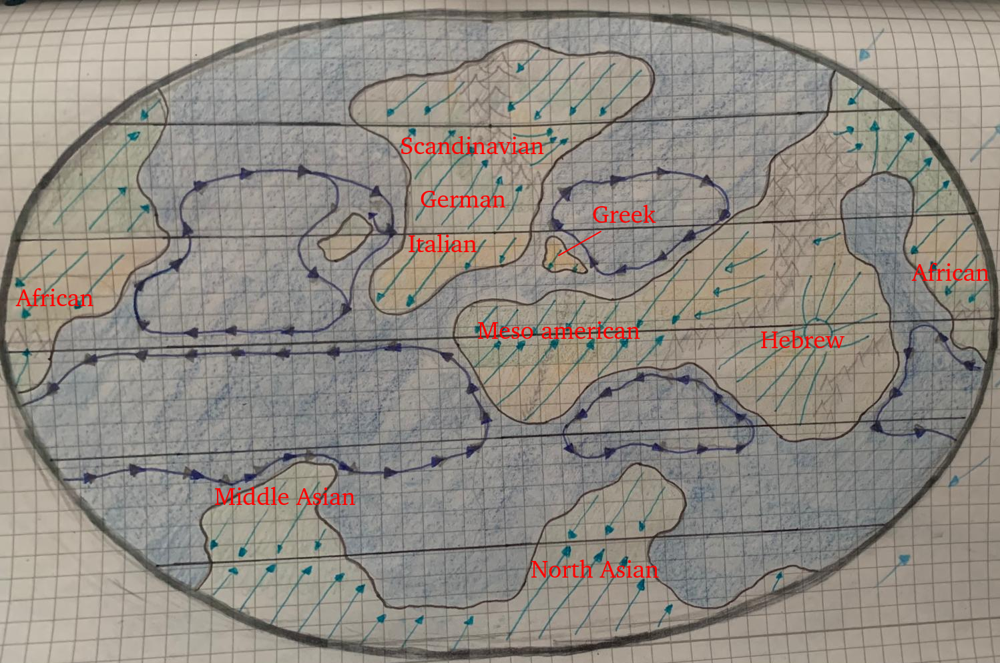

While game will be mainly in your native language, it is way more interesting if cities or places are named to the language you sort to that kindoms or countries.

For example many german cities are called something ending on "burg", "berg" or "hausen", what makes the names (at least for non-natives) more interesting and you get a feeling: "A this sounds similar to the city I where last, language should be similar.". So I applyed some language ideas to the map.

To stick to german, you find it on Continent A. In north you find scandinavian, I mean languages like Finnish or Swedish. Of course this map is not really small scale so you may find some Danish in between.

As I am not really confident about languages there are some categories like meso american. This of course is only a pointer to direction of language you could use there.

# Tables

**Notes on use**
- All names are attested around **1500 (up to about 1520)** or at least plausible. Where sources are scarce (Maya, Kikongo, Amazigh), I have marked this and indicated what is more reconstruction.
- The **example places** are present-day places that show the pattern. Some were only named later.
- Fixed surnames were not yet common in many regions around 1500. Where that is the case, the table lists the naming system (patronymic, origin, title) instead of surnames.
- The Mesoamerica entries are **sorted by later Spanish influence, from low to high**. There was no contact around 1500. For a campaign set around 1520 or later, you can add Spanish baptismal names (Juan, Pedro, María, etc.).

---

## 1. German (Holy Roman Empire, ca. 1500)

### Place-name endings

| Ending | Meaning | Examples |
|---|---|---|
| -burg | castle / fortified town | Würzburg, Hamburg |
| -berg | mountain / hill | Nuremberg, Heidelberg |
| -hausen | "at the houses", settlement | Mühlhausen, Nordhausen |
| -dorf | village | Düsseldorf |
| -stadt | town / site | Darmstadt, Neustadt |
| -furt | ford (river crossing) | Frankfurt, Erfurt |
| -brück(en) | bridge | Saarbrücken, Osnabrück |
| -bach | stream / brook | Ansbach, Offenbach |
| -heim | home / homestead | Mannheim, Pforzheim |
| -ingen | "people of …" (clan suffix) | Göttingen, Tübingen |
| -feld | open field | Bielefeld |
| -weiler / -weil | hamlet | Rottweil |
| -stein | rock / rock castle | Königstein |
| -münster | monastery church / minster | Münster |
| -au | meadow, land by water | Landau |
| -rode / -reuth | clearing (cleared forest) | Wernigerode, Bayreuth |

### First names

| Male | Female |
|---|---|
| Hans, Heinrich, Konrad (Kunz) | Anna, Margarethe (Grete) |
| Friedrich (Fritz), Georg (Jörg) | Katharina (Käthe), Barbara |
| Wolfgang, Ulrich, Lorenz | Elisabeth (Els), Dorothea |
| Albrecht, Martin, Kaspar | Agnes, Ursula, Apollonia |
| Balthasar, Sebastian, Leonhard | Walburga, Kunigunde, Gertrud |
| Veit, Sigmund, Eberhard, Götz | Magdalena, Afra, Brigitta |

### Surnames

| Name | Type / Meaning |
|---|---|
| Müller | occupation: miller |
| Schmidt / Schmied | occupation: smith |
| Schneider | occupation: tailor |
| Weber | occupation: weaver |
| Wagner | occupation: wheelwright / cartwright |
| Meier / Schulte | occupation: steward / village headman |
| Bayer, Schwab, Franke | origin: "the Bavarian / Swabian / Franconian" |
| Klein, Lang, Krause | nickname: small / tall / curly-haired |
| Fuchs, Wolf, Vogel | nickname: fox / wolf / bird |
| Petersen, Jacobs | patronymic (esp. north): "son of Peter / Jacob" |

---

## 2. Scandinavian (Sweden / Norway)

*Around 1500: Kalmar Union, Sten Sture the Elder in Sweden, Norway under the Danish crown.*

### Place-name endings

| Ending | Meaning | Examples |
|---|---|---|
| -by | farm / village | Visby, Täby |
| -stad | place / farmstead / town | Karlstad, Halmstad |
| -vik | bay / inlet | Narvik, Örnsköldsvik |
| -fjord | fjord | Sognefjord |
| -holm | islet | Stockholm |
| -köping / -kjøping | market town | Linköping, Norrköping |
| -borg / -berg | fortress / mountain | Helsingborg |
| -dal | valley | Gudbrandsdal |
| -sund | strait | Haugesund |
| -nes / -näs | headland, ness | Sandnes |
| -ö / -øy | island | Visingsö, Askøy |
| -heim (NO) | home / settlement | Trondheim |
| -land | land | Gotland, Rogaland |
| -torp | outlying farm / croft | very common in Sweden |

### First names

| Male | Female |
|---|---|
| Sten, Sture, Erik | Birgitta, Karin |
| Olof / Olav, Lars, Nils | Kristina, Margareta |
| Per, Anders, Knut | Ingeborg, Sigrid |
| Magnus, Sven, Bengt | Ragnhild, Gunhild |
| Håkon, Harald, Gunnar | Elin, Märta, Brita |
| Torkel, Halvard, Ragnvald | Astrid, Gudrun, Sunniva |

### Surnames

| Name | Type / Meaning |
|---|---|
| -son / -sen (Andersson, Olsen) | patronymic: "son of" |
| -dotter / -datter | patronymic: "daughter of" |
| Haugen, Bakken, Moen | farm name: the hill / the slope / the moor |
| Dahl, Lund, Strand | place: valley / grove / beach |
| Berg, Nes | place: mountain / headland |
| Sture, Vasa | noble houses (Sture, Vasa) |
| Oxenstierna | noble: "ox forehead" |
| Natt och Dag | noble: "Night and Day" |
| Grip | noble: griffin |

---

## 3. Danish (Kingdom of Denmark, under King Hans / Christian II)

### Place-name endings

| Ending | Meaning | Examples |
|---|---|---|
| -by | village | Rødby |
| -borg | castle / fortress | Aalborg, Kalundborg |
| -købing | market town | Nykøbing |
| -sted | place / site | Thisted |
| -rup / -drup / -strup | village (from "-torp") | Ballerup, Glostrup |
| -lev | inheritance / heirloom land | Haderslev, Roslev |
| -holm | islet | Bornholm |
| -havn | harbour | København ("merchants' harbour") |
| -sund | sound / strait | Frederikssund |
| -bæk | brook | Hornbæk, Humlebæk |
| -ø | island | Samsø, Fanø |
| -lund | grove | Lund (then Danish) |
| -rød | clearing | Hillerød, Allerød |

### First names

| Male | Female |
|---|---|
| Christian, Frederik, Hans | Anne, Karen |
| Niels, Jens, Peder | Kirsten, Dorothea |
| Anders, Erik, Mogens | Elisabeth, Margrethe |
| Ove, Tyge, Jørgen | Ingeborg, Maren |
| Christoffer, Knud, Henrik | Birgitte, Sidsel |
| Claus, Otte, Axel | Mette, Else, Cecilie |

### Surnames

*Fixed family names only became established in Denmark in the 19th century. Around 1500, patronymics were used.*

| Name | Type / Meaning |
|---|---|
| Jensen, Hansen, Nielsen, Pedersen | patronymic: "son of Jens / Hans / Niels / Peder" |
| Møller | occupation: miller |
| Smed | occupation: smith |
| Skrædder | occupation: tailor |
| Bonde | status: farmer |
| Brahe | noble house |
| Bille | noble house |
| Trolle | noble: "troll" |
| Rosenkrantz | noble: "rose wreath" |
| Gyldenstierne | noble: "golden star" |

---

## 4. Italian (city-states, Renaissance)

### Place-name endings

| Ending / Element | Meaning | Examples |
|---|---|---|
| -ano / -ana | "estate of [owner]" (Latin -anum) | Cassano |
| -ago / -ate | "estate of …" (Celtic/Latin -acum) | Legnago, Legnate |
| -ello / -etto / -ino | diminutive: "little …" | Castelletto, Torricella |
| Castel(lo)- | castle | Castelfranco |
| Monte- | mountain | Montepulciano |
| Ponte- | bridge | Pontedera |
| Borgo | market town outside the walls | Borgo San Lorenzo |
| Villa- | country estate / village | Villafranca |
| San / Santa | saint | San Gimignano |
| Porto- | harbour | Portofino |
| -poli | city (Greek polis, esp. south) | Napoli, Gallipoli |
| Torre | tower | Torre del Greco |

### First names

| Male | Female |
|---|---|
| Giovanni, Antonio, Francesco | Caterina, Lucrezia |
| Lorenzo, Cesare, Alessandro | Isabella, Beatrice |
| Girolamo, Giuliano, Ludovico | Bianca, Maddalena |
| Niccolò, Piero, Bartolomeo | Giovanna, Margherita |
| Giacomo, Marco, Baldassare | Francesca, Lucia |
| Ippolito, Ercole, Gian Galeazzo | Elisabetta, Vittoria, Giulia |

### Surnames

| Name | Type / Meaning |
|---|---|
| Rossi | nickname: red-haired |
| Bianchi | nickname: white / blond |
| Ferrari | occupation: smith |
| Barbieri | occupation: barber |
| Romano, Greco, Lombardo | origin: "the Roman / Greek / Lombard" |
| Da Vinci | origin: "from Vinci" |
| De Luca | patronymic: "of Luke" |
| Esposito | "exposed", i.e. foundling (south) |
| Medici | "the doctors" (Florence) |
| Sforza | "force" (Milan) |
| Orsini | "little bears" (Rome) |

---

## 5. Greek (Venetian/Ottoman-influenced, Byzantine heritage)

### Place-name endings

| Ending | Meaning | Examples |
|---|---|---|
| -polis / -poli | city | Kallipolis (Gallipoli) |
| -chori / -chorio | village | Mesochori, Neochori |
| -kastro | castle / fortress | Palaiokastro |
| -nisos / -nisi | island | Peloponnisos ("Pelops' island") |
| -vouno / -vouni | mountain | Mavrovouni ("black mountain") |
| -potamos | river | Mesopotamos |
| -livadi | meadow | Livadi |
| -ia | land / region of | Arkadia |
| -ades | group / "people of" (islands) | Kyklades (Cyclades, "ring") |
| -io / -ion | place / diminutive | Nafplio |
| Agios / Agia | saint | Agios Nikolaos |

### First names

| Male | Female |
|---|---|
| Konstantinos, Georgios | Maria, Eleni |
| Ioannis, Nikolaos | Anna, Zoe |
| Dimitrios, Theodoros | Theodora, Irini |
| Manuel, Andreas | Aikaterini, Sofia |
| Alexios, Michail | Eudokia, Anastasia |
| Stephanos, Andronikos, Petros | Despina, Thekla, Kassiani |

### Surnames

| Name / Ending | Type / Meaning |
|---|---|
| -opoulos (Papadopoulos) | patronymic: "son of" (Peloponnese); Papa- = priest |
| -akis (Kalergis, Mavrakis) | diminutive patronymic (Crete) |
| -idis / -ides | patronymic: "son of" (Pontus, Asia Minor) |
| Palaiologos | Byzantine imperial dynasty |
| Kantakouzenos | Byzantine noble house |
| Notaras | Byzantine noble: "notary" |
| Zografos | occupation: painter |
| Psaras | occupation: fisherman |
| Mavros / Mavrogenis | nickname: black / dark-haired |
| Chatzis | status: pilgrim (to Jerusalem) |

---

## 6. Mesoamerican
*(sorted from low to high later Spanish influence)*

> **Note:** The Maya languages are the hardest entries to document. Treat them as well-founded inspiration, not philology.

### 6a. K'iche' (Maya, Guatemalan highlands)

*Conquest only in 1524, fiercest resistance. Capital: Q'umarkaj.*

**Place-name elements** (mostly prefixes)

| Element | Meaning | Example |
|---|---|---|
| Chi- | at / place of | Chi Izmachi |
| Pa- | in / at | Pa Tulul |
| Xe- | beneath / at the foot of | Xelajuj ("below ten", Quetzaltenango) |
| -tinamit / -tenamit | city / fortified town | – |
| Q'umarkaj | "place of old reeds" (capital) | Q'umarkaj |

**First names**

| Male | Female |
|---|---|
| K'iq'ab' (Kikab) | Ixkik' ("Blood Moon") |
| B'alam K'itze' | Ixmukane (grandmother goddess) |
| Tekun (Tecún Umán) | Ixquic |
| Majukutaj | Ixb'alamke? (jaguar-deer), *altered* |
| Iq'i B'alam | – (women often Ix- + nature word) |

**Surnames / affiliation**

| Name | Type / Meaning |
|---|---|
| Kaweq, Nijaib', Ajaw K'iche' | the great lineages |
| Ajpop | title: "keeper of the mat" (ruler) |
| Ajpop K'amja | title: vice-ruler |
| Nim Ch'okoj | title: great councillor |

### 6b. Yucatec Maya

*First Spaniards 1511/1517, conquest completed by 1546. Rival lineages: Xiu, Cocom.*

**Place-name elements**

| Element | Meaning | Example |
|---|---|---|
| -chen | well / cenote | Chichén (Itzá) |
| -ha' / -há | water | Nicté-Há |
| -tun | stone | – |
| -pan | banner / flag | Mayapán |
| -kaan / -kan | sky / snake | Calakmul region |
| Ek' | black / star | Ek' Balam ("Black Jaguar") |

**First names** *(prefix Ah- male, Ix- female)*

| Male | Female |
|---|---|
| Ah Balam (jaguar) | Ix Nicté (plumeria flower) |
| Ah Kin (priest/sun) | Sac-Nicté (white flower) |
| Ah Chan (small / snake) | Ix Kan (yellow / precious) |
| Nachi (e.g. Nachi Cocom) | Ix Chan |
| Ah Pop | Zazil (clear / pure) |

**Surnames** *(inherited patronyms)*

| Name | Type / Meaning |
|---|---|
| Xiu | lineage (Tutul Xiu); "herb / turquoise" |
| Cocom | noble lineage (Sotuta) |
| Pech | "tick" |
| Chel | lineage |
| Canul, Cupul, Couoh | lineages |
| Balam | "jaguar" |
| Dzib | "writing / painting" |
| Ek' | "black / star" |
| May | lineage |

### 6c. Nahuatl (Aztecs, central Mexico)

*Conquest 1519–21, fastest Hispanicization. Afterwards often a baptismal name + Nahuatl name (e.g. "Juan Cuauhtlatoa").*

**Place-name endings**

| Ending | Meaning | Examples |
|---|---|---|
| -tlan / -titlan | among / near / abundance of | Cuauhtitlan ("among the trees") |
| -co | in / at (place) | Xochimilco ("flower field place") |
| -pan | on / over | Tlalpan ("on the earth") |
| -apan | on the water | – |
| -tepec | on the hill | Chapultepec ("grasshopper hill") |
| -tenanco | at the wall / rampart | Tenancingo |
| -calco | in the house of | Xalapa region |
| -huacan | place of those who have | Teotihuacan |
| -nahuac | near / beside | Cuernavaca (Cuauhnahuac) |
| -tzinco | at the little … (honorific) | Ahuehuetzingo |

**First names**

| Male | Female |
|---|---|
| Cuauhtémoc ("descending eagle") | Xochitl ("flower") |
| Moctezuma ("angry lord") | Citlali ("star") |
| Cuitláhuac | Quetzalli ("precious feather / beautiful") |
| Nezahualcoyotl ("hungry coyote") | Atotoztli ("water parrot") |
| Itzcoatl ("obsidian serpent") | Tecuichpo ("royal lady") |
| Axayacatl ("water face") | Papantzin ("butterfly") |
| Tlacaelel, Ahuízotl | Miahuaxihuitl ("turquoise maize flower") |
| Ocelotl ("jaguar") | Yoloxochitl ("heart flower") |

**Surnames / affiliation** *(no family names)*

| Element | Meaning |
|---|---|
| Tlatoani | "speaker" = ruler |
| Tecuhtli | lord |
| Pilli | noble |
| Macehualli | commoner |
| Cihuacoatl | "snake woman" = vice-ruler |
| Day names (Ce Acatl) | e.g. "One Reed", from the day of birth |

---

## 7. Near East

### 7a. Persian (Safavids, Shah Ismail I)

From 1501, Iran became Shia. Names from Ali's family are therefore common.

**Place-name endings**

| Ending | Meaning | Examples |
|---|---|---|
| -abad | settled place / town | Khorramabad ("pleasant town") |
| -stan | land of | Golestan ("land of roses") |
| -shahr | city | Bushehr (from Bushahr) |
| -kuh | mountain | – |
| -rud / -rood | river | Zayanderud |
| -dasht | plain | – |
| -deh | village | – |
| -an / -jan | place of (plural) | Isfahan, Hamadan |
| -kand | town / city | Samarkand |
| -gerd / -gird | round fort / town | Darabgerd |
| -zar | place of plenty | Golzar ("rose garden") |
| -pol | bridge | Pol-e Khaju |

**First names**

| Male | Female |
|---|---|
| Ismail, Tahmasp | Zahra, Fatemeh |
| Mohammad, Ali, Hasan, Hosein | Maryam, Shirin ("sweet") |
| Rostam, Sohrab, Esfandiar | Mahin ("moonlike") |
| Bahram, Kaveh, Babak | Parvin ("Pleiades") |
| Khosrow, Shapur, Jamshid | Golnar ("pomegranate flower") |
| Yusuf, Ibrahim, Jafar | Laleh ("tulip"), Pari ("fairy") |

**Surnames / affiliation** *(epithets instead of family names)*

| Name | Type / Meaning |
|---|---|
| -i (Shirazi, Tabrizi, Isfahani) | nisba: "from [city]" |
| -zadeh | "son of" |
| Mirza, Khan, Beg | titles (prince / lord / chief) |
| Ahangar | occupation: blacksmith |
| Zargar | occupation: goldsmith |
| Attar | occupation: perfumer / apothecary |
| Khayyam | occupation: tentmaker |
| Naqqash | occupation: painter |
| Ustajlu, Shamlu, Rumlu, Afshar, Qajar | Qizilbash tribes |

### 7b. Arabic (Hejaz / Arabian Peninsula, Mamluks, Ottoman from 1517)

**Place-name elements**

| Element | Meaning | Examples |
|---|---|---|
| Al- | "the" | Al-Madina |
| Madinat | city | Madinat al-Munawwara |
| Bir | well | Bir Ali |
| Wadi | valley / dry riverbed | Wadi Rum |
| Jabal | mountain | Jabal Uhud |
| Ras | headland ("head") | Ras Tanura |
| Qasr | castle / palace | – |
| Hisn | fort | – |
| Ain / Ayn | spring ("eye") | Ayn Jalut |
| Dar | house / home | – |
| Umm / Abu | "mother of / father of" (place of plenty) | Umm al-Qura |
| Rawda | garden / meadow | – |

**First names**

| Male | Female |
|---|---|
| Muhammad, Ahmad | Fatima, Aisha |
| Abdullah ("servant of God") | Khadija, Zaynab |
| Ali, Hasan, Husayn | Maryam, Hafsa |
| Umar, Uthman | Amina, Layla |
| Ibrahim, Yusuf, Musa | Sara, Salma, Hind |
| Khalid, Hamza, Salim, Mansur | Safiyya, Rabia, Halima |

**Surnames / affiliation**

| Name | Type / Meaning |
|---|---|
| ibn / bint + father | "son / daughter of" |
| Abu / Umm + child | "father / mother of" (kunya) |
| al-Makki, al-Madani, al-Hijazi | nisba: from Mecca / Medina / Hejaz |
| al-Najdi, al-Shami, al-Baghdadi | nisba: from Najd / Syria / Baghdad |
| al-Harbi, al-Otaibi, al-Zahrani | tribal names |
| al-Qurashi | from the tribe of Quraysh |
| al-Haddad | occupation: smith |
| al-Najjar | occupation: carpenter |
| al-Khayyat | occupation: tailor |
| al-Attar | occupation: perfumer |

---

## 8. Mongolia

*Around 1500: Dayan Khan unites the eastern Mongols, Mandukhai Khatun rules as regent. Still shamanic/Tengrist; Buddhist names only appear after about 1570.*

### Place-name endings

| Ending | Meaning | Examples |
|---|---|---|
| -khot / -khoto | city | – |
| -uul | mountain | Bogd Khan Uul |
| -nuur | lake | Khökh Nuur ("blue lake") |
| -gol | river | Orkhon Gol |
| -khiid | monastery (later) | Erdene Zuu Khiid |
| -tal | steppe / plain | – |
| -ovoo | stone cairn (shrine) | – |
| -bulag | spring | – |
| -tolgoi | hill ("head") | – |
| Khar / Khökh / Ulaan | black / blue / red | Kharkhorin ("black rubble") |

### First names

| Male | Female |
|---|---|
| Batu ("firm") | Mandukhai |
| Temür ("iron") | Sarnai ("rose") |
| Bolod ("steel") | Oyun ("wisdom") |
| Bayan ("rich") | Tuya ("ray") |
| Mönkh ("eternal") | Khulan ("wild ass") |
| Esen ("healthy") | Börte, Naran ("sun") |
| Dayan ("all-encompassing") | Gerel ("light"), Saran ("moon") |
| Arslan ("lion"), Altan ("gold") | Tsetseg ("flower"), Nomin ("jade") |

### Surnames / affiliation

| Name | Type / Meaning |
|---|---|
| Patronym in the genitive | e.g. "Batu's Temür" = Temür, son of Batu |
| Borjigin | imperial clan |
| Khorchin, Khalkha, Chakhar, Tumed, Ordos | tribal groups |
| Oirat | western Mongol confederation |
| Khan / Khatun | ruler / lady |
| Noyon, Taiji | lord / prince |
| Bagatur, Setsen | "hero" / "wise" (honorific epithets) |

---

## 9. Russian (Grand Duchy of Moscow, Ivan III / Vasily III)

### Place-name endings

| Ending | Meaning | Examples |
|---|---|---|
| -grad / -gorod | city / fortress | Novgorod ("new city") |
| -sk | place at … (from river/name) | Smolensk, Pskov |
| -ovo / -evo | village of [owner] | Domodedovo |
| -ino / -yino | village of [owner/place] | Borodino |
| -skoye / -skoe | (village) of … | Kolomenskoye |
| -pol | city (from Greek polis) | Sevastopol |
| -ovka | small village | – |
| -sloboda | free settlement | Aleksandrovskaya Sloboda |
| -avl | (from the name Yaroslav) | Yaroslavl |
| -gorsk | mountain town | – |

### First names

| Male | Female |
|---|---|
| Ivan, Vasily, Dmitri | Maria, Anna |
| Fyodor, Andrei, Yuri | Anastasia, Evdokia |
| Mikhail, Semyon, Bogdan | Elena, Sofia |
| Afanasy, Ignaty, Boris | Marfa, Ulyana |
| Gleb, Vladimir, Yaroslav | Fevronia, Agrafena |
| Stepan, Timofey | Irina, Ksenia, Pelageya |

### Surnames

*True family names around 1500 were mostly used only by boyars. Everyone else used a patronymic and a nickname.*

| Name / Ending | Type / Meaning |
|---|---|
| -ovich / -evich | patronymic (male): "son of" |
| -ovna / -evna | patronymic (female): "daughter of" |
| -ov / -ev / -in | surname: "belonging to" (Vorontsov) |
| -sky / -skoy | surname: "of [place]" (Shuysky, Belsky) |
| Obolensky | princely house |
| Vorontsov | "of the raven" |
| Kuznetsov | occupation: smith |
| Mel'nik | occupation: miller |
| Medved | nickname: bear |

---

## 10. Africa

> The entries for Kikongo and Tamazight are the thinnest in documentation. **Names marked with \*** are modern revivals and are best understood as flavor.

### 10a. North Africa: Amazigh / Tamazight (Berber, Morocco/Algeria)

**Place-name elements**

| Element | Meaning | Examples |
|---|---|---|
| Ait / Ayt / At | "people of / sons of" | Ait Benhaddou |
| Tin- / Ti- | "she of / place of" (fem.) | Tin Hinan ("she of the tents") |
| Tizi | mountain pass | Tizi Ouzou |
| Ighil | hill / arm of a mountain | Ighil Ali |
| Asif | river | Asif Melloul |
| Adrar | mountain | Adrar |
| Ifri / Ifran | cave(s) | Ifrane |
| Azrou | rock | Azrou |
| Ain (Arabic) | spring | Aïn Témouchent |
| Ksar (Arabic) | fortified village | Ksar Ait Benhaddou |

**First names** *(many Amazigh already bore Arabic-Islamic names)*

| Male | Female |
|---|---|
| Mohand (Muhammad), Ali | Fadhma (Fatima) |
| Idir ("to live") | Aïcha, Zahra |
| Arezki ("prosperity") | Taous ("peacock") |
| Amghar ("chief / elder") | Tiziri\* ("moonlight") |
| Amastan\* | Dihya\* ("queen") |
| Aksil\* ("leopard") | Tilelli\* ("freedom") |

**Naming system** *(instead of surnames)*

| Pattern | Meaning |
|---|---|
| Ait / At + clan | "people of …" |
| U / Ou + father | "son of" (Ou Brahim) |
| Bu / Bou + trait | "master of / father of" |
| Ben / Ouled + name | "son(s) of" (Arabic) |
| Nisba (al-Fassi) | "from [city]" |

### 10b. Central Africa: Kikongo (Kingdom of Kongo)

*Portuguese contact since 1483, baptism of the king in 1491 (Nzinga a Nkuwu → João I). Afonso I (Mvemba a Nzinga) rules from about 1509.*

**Place-name elements** *(prefix structure, not suffix)*

| Element | Meaning | Example |
|---|---|---|
| Mbanza | town / capital | Mbanza Kongo |
| Nsi | country / land | Nsi a Kongo |
| Mwene / Mani | lord / ruler of | Mani Soyo ("lord of Soyo") |
| Nzadi | river | origin of "Zaire" |
| Mfinda | forest | – |
| Kanda | clan / lineage | – |

**First names** *(+ Portuguese baptismal names: Afonso, João, Pedro, Diogo, Garcia, Henrique)*

| Male | Female |
|---|---|
| Nzinga | Nzinga (unisex) |
| Mvemba | Zola ("love") |
| Mpanzu | Nsimba |
| Nkuwu | Kimpa |
| Kitima, Lukeni | Mbumba |

**Naming system**

| Pattern | Meaning |
|---|---|
| X a Y | "X, [son] of Y" (Mvemba a Nzinga) |
| Kimpanzu, Kinlaza | the two great royal houses |
| Mani / Mwene + province | titles of provincial governors |
| Ntotila | title: king |

### 10c. Southern Africa: isiZulu / Nguni

*The Zulu Kingdom only arose in 1816. Around 1500 there were Nguni clans (Dlamini, Khumalo, etc.), and the clan names are old.*

**Place-name elements**

| Element | Meaning | Examples |
|---|---|---|
| KwaX- | place of X | KwaZulu, KwaMashu |
| e- … -eni | in / at (locative) | eThekwini (Durban) |
| Mpumalanga | "where the sun rises" (east) | Mpumalanga |
| uMzi- / umuzi | homestead | uMzimkhulu ("great home / river") |
| Ulundi | high place | Ulundi |
| uMgungundlovu | "secret place of the elephant" | – |
| eMalahleni | place of coal | – |
| Nkosi- | chief | – |

**First names**

| Male | Female |
|---|---|
| Sipho ("gift") | Nandi ("sweet one") |
| Themba ("trust / hope") | Zanele ("they are enough") |
| Mandla ("strength") | Thandiwe ("beloved") |
| Sizwe ("nation") | Lindiwe ("awaited") |
| Mthunzi ("shade") | Nomvula ("mother of rain") |
| Thulani ("be calm") | Nokuthula ("peace") |
| Jabulani ("rejoice") | Busisiwe ("blessed") |
| Zwelethu ("our land") | Mbali ("flower") |

**Surnames** *(izithakazelo / clan names)*

| Name | Meaning |
|---|---|
| Ndlovu | "elephant" |
| Nkosi | "chief" |
| Dlamini | clan name |
| Khumalo | clan name |
| Mthembu | clan name |
| Mkhize | clan name |
| Ngcobo | clan name |
| Sithole | clan name |
| Zulu | "sky / heaven" |
| Buthelezi | clan name |
