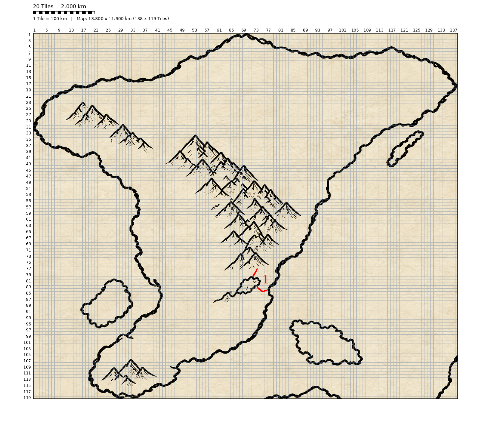

# `Continent A`

# Windmark

The Windmark is located between `Mountains 1` and `Ozean 1`. It is called this way because of the heavy north-east-wind steered along the mountains and therefore hitting the windmark with full power.

For more information check [here](./Windmark/Windmark.md).

