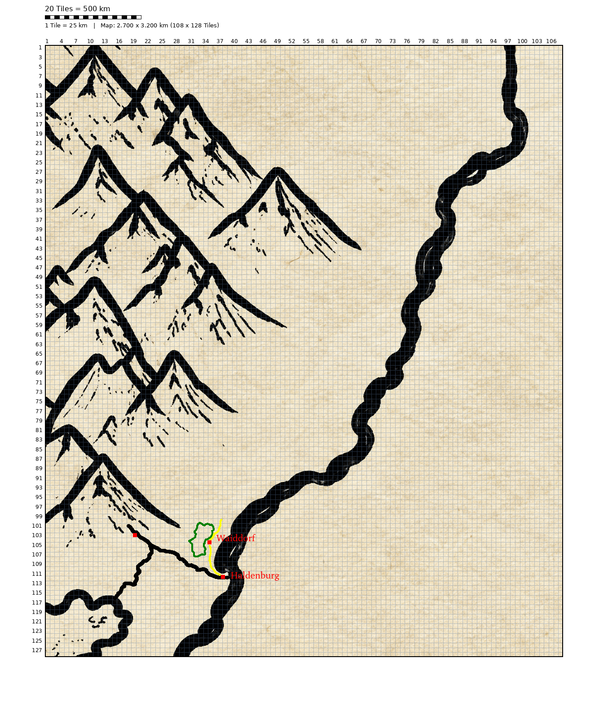

# Windmark

The location of Windmark are quite pitty. It is cold, the wind storms often and the ground is often hard. But the `Edelberge` lure with Gold.
But the dwarves already claimed those riches and could defend themself in multiple wars. 
After that the humans followed the Flow of the Gold river down and foundet another kingdom: The windmark.

Following centuries the humans pan much of the Gold out of the `Goldstrom` and the `Windmark` became a rich city.
And after all those centuries and as the gold was gone the humans begane to lurk to the mountains again. But this time there was no war, but a contract, so the dwarfes could make use of all the peat in the swamps and they would pay a lot of gold.

So the kingdoms became partners and there was a big time of peace continuing to nower days.

# Cities

- [Haldenburg](./Places/Haldenburg.md)

